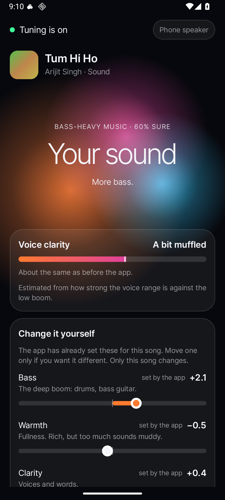

# Audito Amplificus

## Get more from the headphones you already own.

I wanted better sound without making another pair of expensive earbuds the first step. I also did not want to spend every song moving an equaliser around.

Audito measures what is playing, adjusts the sound, and lets you teach it what you like. The Android and Windows apps share the same tuning brain.

**[Download the Android APK](https://github.com/Arnav-Agarwal137/audito-amplificus/releases/download/v0.1.17/Audito-Amplificus-0.1.17.apk) · [Release notes](https://github.com/Arnav-Agarwal137/audito-amplificus/releases/tag/v0.1.17) · [Build for Windows](docs/BUILDING.md#build-the-laptop-app)**

<p align="center"></p>

*Android development capture. The release's layout may differ slightly.*

## Give it one song

1. Install the APK on **Android 9 or newer**. If your browser asks, allow installation from that source for this download; you can turn that permission off afterwards.
2. Open Audito and follow its setup pages. Each permission has an explanation.
3. Play something in the app you normally use and switch tuning on.
4. Try **Hear the difference**. There is a bundled demo song if nothing is playing.
5. Adjust bass, warmth, voice clarity or treble if you want, then keep a sound you like.

The before/after comparison is designed to match loudness, so louder does not automatically win. How much difference you hear depends on your phone, output device, music and settings. This is sound processing, not a promise to reproduce another headphone's hardware or noise cancellation.

## What it does

- Tunes the audio already playing instead of asking you to switch music players.
- Keeps preferences for different listening setups and learns from the settings you keep.
- Gives a listening-level estimate and a weekly exposure guide on Android.
- Offers optional 8D file processing; Windows tools can also make music-only copies or clean up talks when their separate dependencies are installed.

**Android:** a public APK is available. **Windows 10/11:** the app is in the source tree and uses Equalizer APO; this repo currently has no public Windows installer. **iPhone:** no version is available.

## The privacy part is worth reading

The Android app's manifest declares **no internet permission**. Its playback analyser uses Android's Visualizer to measure the output mix. It does not open a microphone recorder or save audio recordings.

Android still calls the required `RECORD_AUDIO` permission microphone access. That name is alarming, so setup explains why it is requested: output analysis. Inspect [the manifest](app/src/main/AndroidManifest.xml) and [Analyzer.kt](app/src/main/java/com/arnavagarwal/sound/engine/Analyzer.kt).

Other permissions cover recognising connected headphones, reading the current media session and keeping tuning running. Windows measures playback through loopback. Optional Windows file tools may download dependencies or model weights separately. See [PRIVACY.md](PRIVACY.md).

Listening estimates are approximate. Audito is not a hearing test or a medical device; see [DISCLAIMER.md](DISCLAIMER.md).

## For people who want to inspect the build

The phone UI is Kotlin and Jetpack Compose. Shared Kotlin code in `core/` makes tuning decisions; Android audio effects and the Windows playback chain apply them on their respective platforms.

```text
Playing audio -> playback measurements -> shared tuning brain -> output processing
                                              ^
                                      settings you choose to keep
```

[Build instructions, tests and uninstall details](docs/BUILDING.md) include Android, Windows, optional file tools and signing with your own key. Tests cover the shared brain, interface wording and privacy constraints; sound preference still needs a human listener.

The APK is **v0.1.17**, about **3.6 MB**. GitHub reports this SHA-256:

```text
914dc2673728cd319a86377afa9fc468e78ea095d408bfe1c76d118ab921cf4a
```

The checksum identifies the published file; it is not a security certification. Download from the release above. If the effect does not reach an output device, report the OS version and headphone connection type in [an issue](https://github.com/Arnav-Agarwal137/audito-amplificus/issues).

## Credits and permissions

Libraries, font, demo song, HRTF data and optional tools have their own terms in [THIRD-PARTY-NOTICES.md](THIRD-PARTY-NOTICES.md). Third-party model weights are not bundled; the app's licence cannot grant rights to them.

Built by [Arnav Agarwal](https://github.com/Arnav-Agarwal137). Audito is independent of headphone manufacturers, music services and their products.

## Licence

Free noncommercial use and private improvements are permitted for newly licensed original work.
Share the official links freely. Redistributing copies, publishing modified versions, public mirrors,
rebranding, and commercial use require Arnav Agarwal's prior written permission.
Keep authorship and required notices. This is a source-available custom licence, not an open-source licence.
Earlier licence grants and third-party rights remain in force; see [LICENSE-HISTORY.md](LICENSE-HISTORY.md).
Previously published source, embedded app notices, tags and downloadable binaries retain their earlier grants;
this policy does not retroactively prohibit their previously permitted use or distribution.

Full terms: [LICENSE](LICENSE). Permission requests: [GitHub issues](https://github.com/Arnav-Agarwal137/audito-amplificus/issues).

**Exception:** `windows/apo-setup/` remains GPL-2.0-or-later under its own COPYING and NOTICE.md.
